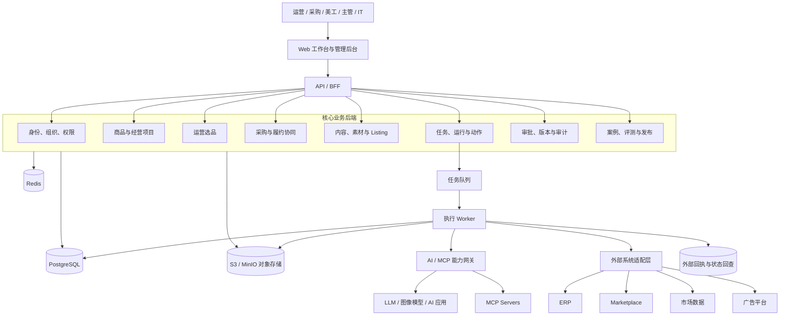
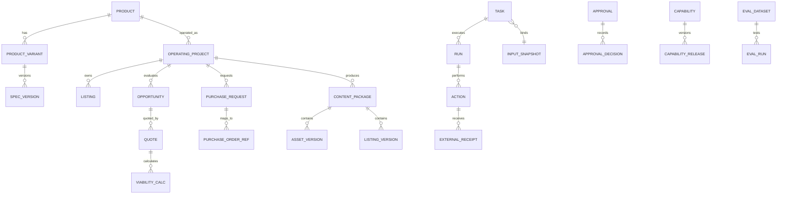
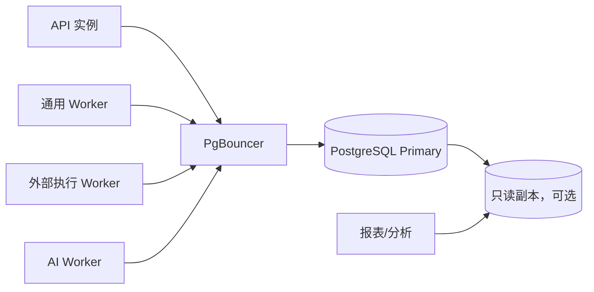

# AI 商品运营中台整体架构方案

> 状态：架构建议稿；核心后端使用 FastAPI 已确认，其余待项目负责人确认后再拆分为正式 ADR、数据库设计与实施计划。
>
> 适用范围：首个生产版本及其后续渐进式扩展。

## 1. 架构目标

本系统不是若干 AI 工具的菜单集合，而是围绕商品全生命周期建立统一业务中台。系统必须同时支撑：

1. 运营选品、询价测算、运营认领、采购、内容生产、Listing、发布和后续经营。
2. 商品、规格、经营项目、任务、审批、版本与外部回执的完整追踪。
3. 人工责任边界：AI 可以建议、生成、校验和解释，但不能自行批准采购、发布、广告预算等高风险动作。
4. AI 能力的可替换接入，以及案例、评测、灰度、发布、监测和回滚闭环。
5. ERP、Marketplace、广告平台等权威系统与中台之间清晰的数据边界。

首版推荐采用：

> **模块化单体业务后端 + 独立异步 Worker + 统一任务编排 + AI/MCP 能力网关 + PostgreSQL 主库。**

该形态比一开始拆分微服务更容易保证业务事务、权限和审计一致性，同时保留按模块和负载拆分服务的能力。

## 2. 总体架构



### 2.1 分层原则

| 层级 | 职责 | 不应承担 |
|---|---|---|
| 前端体验层 | 岗位工作台、录入、预览、审批、异常处理 | 权限最终判断、关键业务规则 |
| API/BFF 层 | 登录会话、接口聚合、DTO 校验、限流 | 绕过领域服务直接写表 |
| 应用服务层 | 用例编排、事务边界、授权检查、任务创建 | 供应商 SDK 细节 |
| 领域层 | 核心对象、状态机、业务规则、不变量 | 网络请求和 UI 逻辑 |
| 任务执行层 | 异步任务、重试、幂等、外部执行、回查 | 审批决策 |
| 集成与能力层 | ERP、平台、AI、MCP 的统一适配 | 成为业务事实的唯一存储 |
| 数据层 | 事务数据、快照、审计、缓存、文件 | 用缓存替代正式事实 |

## 3. 推荐技术基线

以下为首版建议，不属于不可变决定。

| 范围 | 推荐技术 | 选择理由 |
|---|---|---|
| 前端 | Next.js + React + TypeScript | 工作台、管理端、SSR/CSR 混合能力成熟 |
| UI | Tailwind CSS + shadcn/ui | 快速建立统一设计系统，组件可控 |
| 数据请求 | TanStack Query | 服务端数据缓存、刷新、错误状态清晰 |
| 表单 | React Hook Form + Zod | 复杂业务表单与前后端类型校验 |
| 核心后端 | Python 3.12+ + FastAPI + Pydantic v2 | 已确认；统一业务 API、数据契约与 AI 生态，支持异步 I/O |
| 应用服务器 | Uvicorn workers（由 Gunicorn 或容器编排管理） | 生产进程管理、优雅关闭与横向扩展 |
| 主数据库 | PostgreSQL | 强事务、JSONB、审计查询和复杂关联能力 |
| ORM/迁移 | SQLAlchemy 2.x + Alembic | Python 原生、显式事务、异步数据库访问与可靠迁移 |
| 缓存与任务队列 | Redis + Celery | 首版任务调度、重试、限流、短期缓存和并发控制 |
| 文件存储 | S3 兼容对象存储；本地用 MinIO | 图片、视频、输入输出包、快照和评测产物版本化 |
| 搜索 | 首版 PostgreSQL FTS；规模化后 OpenSearch | 避免首版引入过多基础设施 |
| API | REST/OpenAPI；事件使用内部领域事件 | 对业务系统和外部适配简单、可测试 |
| 可观测性 | OpenTelemetry + Prometheus/Grafana + 集中日志 | 统一 trace_id、指标与告警 |
| 部署 | Docker；首版单环境编排，后续 Kubernetes | 先保证可重复部署，再按规模升级 |

### 3.1 为什么不首版全面微服务化

- 商品、版本、审批、采购和内容包存在大量强事务关系。
- 团队在早期更需要稳定边界和快速验证，而不是分布式事务。
- 模块化单体仍通过模块 API、领域事件和独立数据访问层维持边界。
- AI 运行、媒体处理、平台执行等资源与风险不同的工作，从第一天就放入独立 Worker；未来可优先拆出。

## 4. 前端架构

### 4.1 应用划分

```text
frontend/
  web/                 # 岗位业务工作台
  admin/               # 用户、权限、审批规则、能力发布、审计
  packages/
    ui/                # 统一组件和设计 Token
    api-client/        # OpenAPI 生成客户端
    auth/              # 登录、会话、前端权限展示辅助
    domain-view-models/# 共享视图模型
```

`web` 与 `admin` 可以先作为同一 Next.js 工程的两个路由域；只有发布节奏、网络边界或团队所有权发生明显分离时再拆成两个部署单元。

### 4.2 岗位工作台

| 岗位 | 首屏重点 |
|---|---|
| 运营 | 待评估机会、已认领项目、Listing 状态、异常与经营任务 |
| 采购 | 待询价、待确认规格、待审批采购建议、到货/交期异常 |
| 美工 | 待制作素材、规格与文案约束、版本对比、审核退回 |
| 主管 | 待审批、高风险异常、项目进度、质量与成本 |
| IT/管理员 | 集成健康、任务失败、权限、能力版本、审计 |

### 4.3 前端权限边界

- 前端根据权限隐藏或禁用控件，只用于改善体验。
- 每次读取、修改、审批和外部执行均由后端基于用户、组织、店铺、动作和对象范围重新授权。
- 高风险动作前端必须展示目标对象、批准版本、影响范围和幂等请求号。
- “未知”“缺失”“估算”“失败”“零”“已确认”必须使用不同状态，不允许都渲染成空白或 `0`。

## 5. 后端架构

### 5.1 模块划分

```text
backend/
  api/
    app/
      main.py            # FastAPI 应用入口与生命周期
      api/               # 路由、请求响应模型、依赖
      core/              # 配置、安全、数据库、日志
      modules/
      identity/        # 用户、组织、角色、服务身份
      authorization/   # RBAC + 对象/店铺范围策略
      product/         # 商品主档、变体、规格版本
      project/         # 经营项目、认领、负责人
      selection/       # 机会、选品任务、证据、评审
      quotation/       # 询价、成本项、可售性测算
      procurement/     # 采购申请、订单映射、履约协同
      content/         # 内容需求、素材、内容包
      listing/         # Listing 草稿、版本、校验、发布准备
      workflow/        # 任务、运行、动作、状态机
      approval/        # 审批策略、审批实例、签署结果
      capability/      # AI/MCP 能力目录与发布版本
      evaluation/      # 案例、数据集、评测、候选发布
      integration/     # 外部连接、映射、回执与回查
      audit/           # 审计事件和查询
      domain/            # 纯领域对象与规则
      services/          # 跨模块应用用例
      repositories/      # SQLAlchemy 仓储实现
  workers/
    orchestration/     # 任务调度、超时、重试、补偿
    ai/                # 文本、图像、评测任务
    external-actions/  # ERP/平台等外部写入
    reconciliation/   # 外部状态回查和差异对账
```

### 5.2 核心状态模型

所有长流程不得用一个同步 HTTP 请求完成。建议统一使用如下模型：

```text
Task（业务请求）
  └─ Run（一次执行尝试）
      └─ Action（一个可审计步骤或外部动作）
          └─ Receipt（外部回执或状态核对结果）
```

- `task_id`：用户能看到的业务任务。
- `run_id`：任务的一次执行，可重试但不能覆盖历史运行。
- `action_id`：具体步骤，尤其是外部写动作的幂等键。
- `external_receipt_id`：外部平台返回的请求号、单号或结果标识。
- 每次运行绑定 `input_snapshot_id`、`spec_version`、`capability_release_id` 和必要的审批记录。

建议任务状态：

```text
draft -> queued -> running -> waiting_human / waiting_external
      -> succeeded / failed / cancelled / needs_reconciliation
```

外部写动作状态：

```text
prepared -> approval_required -> approved -> dispatching
         -> accepted -> confirmed
         -> rejected / failed / unknown -> reconciling
```

`unknown` 不能直接重试写入；必须先依据 `action_id` 或外部回执查询，防止重复上架、重复采购等事故。

### 5.3 事务与事件

- 单个业务用例优先使用 PostgreSQL 本地事务。
- 每个 HTTP 请求或 Worker 任务使用独立 SQLAlchemy `AsyncSession`，由应用服务显式控制提交与回滚。
- 事务内同时写业务数据和 `outbox_event`。
- 独立发布器将 Outbox 事件投递至队列，避免数据库已提交但任务未发布。
- 消费者使用 `event_id/action_id` 做幂等去重。
- 外部写入采用“准备 -> 审批 -> 执行 -> 回执 -> 回查”的 Saga/补偿流程，不使用跨系统分布式事务。

## 6. 数据架构与数据库连接

### 6.1 存储分工

| 存储 | 内容 | 约束 |
|---|---|---|
| PostgreSQL | 商品、项目、任务、版本、审批、映射、审计索引 | 唯一正式业务主库 |
| S3/MinIO | 图片、视频、文件、输入输出快照、内容包 | 文件不可原地覆盖，按版本寻址 |
| Redis | 缓存、锁、限流、队列状态 | 不作为业务事实来源 |
| 外部系统 | ERP 库存/采购/发运事实，平台发布结果等 | 通过映射与同步记录引用 |

### 6.2 数据域与关键表



建议按 Schema 或模块明确所有权：

- `iam_*`：用户、组织、角色、权限、服务账号、店铺授权。
- `catalog_*`：商品、变体、规格、规格版本、供应商关联。
- `project_*`：经营项目、负责人、店铺与站点范围。
- `selection_*`：机会、候选、证据快照、评分与评审结果。
- `quote_*`：报价、费用项、汇率来源、测算版本。
- `procurement_*`：采购申请、行项目、ERP 映射、履约状态镜像。
- `content_*`：内容需求、素材、素材版本、内容包。
- `listing_*`：Listing、字段版本、校验结果、平台映射。
- `workflow_*`：任务、运行、动作、回执、Outbox、幂等记录。
- `governance_*`：审批、审计、快照、保留策略。
- `ai_*`：能力、版本、案例、评测集、评测运行、发布与路由。

### 6.3 数据库连接方式



- FastAPI 路由只负责协议转换、依赖注入与返回结果，不直接操作 ORM 模型。
- 应用服务只通过仓储接口访问数据库，模块不得直接访问其他模块的私有表。
- SQLAlchemy 使用异步 PostgreSQL 驱动；请求级 `AsyncSession` 不跨请求、不跨并发任务共享。
- 生产使用独立数据库账号：迁移账号、API 读写账号、Worker 账号、只读报表账号。
- 连接串和密钥进入 Secret Manager，不写入仓库或数据库普通字段。
- 使用 PgBouncer 控制连接数；API 和 Worker 设置不同连接池上限。
- 数据库迁移由 CI/CD 单独执行，应用启动不自动修改生产结构。
- 关键业务表使用乐观锁版本号，防止页面过期数据覆盖新版本。
- 敏感字段采用列级加密或密钥引用；审计日志不得记录密钥与完整敏感负载。

### 6.4 数据语义

对金额、尺寸、重量、时间和指标建立结构化值对象：

```text
Money: amount + currency + tax_basis + exchange_rate_ref
Measure: normalized_value + normalized_unit + original_value + original_unit
ObservedValue: value + value_status + source + observed_at + collected_at
```

`value_status` 至少包含：`missing | zero | estimated | failed | unavailable | confirmed`。

## 7. 四个核心应用域

### 7.1 运营选品

流程：

```text
创建选品任务
-> 固化站点、关键词/ASIN、规则和数据快照
-> 调用一个或多个选品能力
-> 生成候选、证据、风险和缺失项
-> 运营人工评审
-> 进入询价/测算或驳回
-> 通过后建立经营项目
```

设计要点：

- 各选品 Skill 保留自己的评分逻辑，通过统一输入输出契约接入。
- AI 结果必须附带证据引用、数据时间、能力版本和置信/缺失说明。
- 推荐结果不直接成为“可采购”结论。
- 真实员工修订可进入待审核案例库，但不自动训练或更新正式能力。

核心接口示例：

```http
POST /api/v1/selection-tasks
POST /api/v1/selection-tasks/{id}/runs
GET  /api/v1/selection-tasks/{id}/candidates
POST /api/v1/opportunities/{id}/reviews
POST /api/v1/opportunities/{id}/convert-to-project
```

### 7.2 采购

流程：

```text
已通过机会/经营项目
-> 供应商询价
-> 费用和可售性测算
-> 固化采购规格版本与数量
-> 发起审批
-> 经批准后写入/同步 ERP
-> 回收 ERP 单号和状态
-> 到货、质检、异常与履约跟踪
```

设计要点：

- 采购单必须引用批准的 `spec_version`、报价版本与审批记录。
- 程序负责公式计算，AI 只解释风险与缺失项。
- ERP 是正式采购、库存和发运事实来源；中台保存计划、映射、快照和协同任务。
- ERP 超时后进入 `unknown/needs_reconciliation`，不可盲目重复提交。

### 7.3 美工生图与素材生产

流程：

```text
内容需求单
-> 读取批准规格、品牌规则和目标平台要求
-> 生成提示词/拍摄或设计 Brief
-> AI 生图或人工上传
-> 自动技术检查
-> 美工修订
-> 业务/合规审核
-> 形成不可变素材版本
-> 纳入内容包
```

设计要点：

- 原始图、生成图、编辑图、最终图分层保存，保留派生关系。
- 每次生成保存模型、参数、提示词版本、输入素材、运行编号与使用权信息。
- 自动检查尺寸、比例、分辨率、文件格式、缺图、文字与平台约束。
- 正式发布只能引用审核通过的素材版本，不能引用“文件夹最新图片”。

### 7.4 Listing 编写

流程：

```text
选择经营项目和店铺
-> 锁定商品规格版本、素材和目标语言
-> 生成标题、要点、描述、关键词等草稿
-> 事实一致性与平台规则校验
-> 运营修订
-> 审核并冻结 Listing 版本
-> 与素材组成发布内容包
-> 提交平台并异步回查
```

设计要点：

- Listing 文本字段结构化存储，不只保存一个富文本文件。
- 文案中的每项产品事实可追溯到规格字段或已批准来源。
- 不同店铺、站点、语言分别版本化，不能互相覆盖。
- 平台发布使用批准的内容包快照；发布后保留平台回执与实际生效内容。

## 8. AI 与 MCP 接入架构

### 8.1 能力网关

所有 AI、Skill、MCP 和第三方应用先注册为 `Capability`，业务模块不直接绑定具体模型或 MCP 工具名。

```text
业务用例
-> capability_id + capability_release_id
-> 能力网关解析路由
-> Provider Adapter / MCP Client / Existing Tool Adapter
-> 标准化结果、证据、成本和错误
```

能力登记至少包含：

- 能力 ID、用途、负责人和风险级别。
- 输入/输出 JSON Schema。
- 允许的业务域、环境、组织、店铺和调用模式。
- 是否允许外部写入；默认只读。
- 版本、提供方、模型/工具配置引用。
- 超时、重试、预算、速率和并发限制。
- 数据分类、敏感数据策略和日志脱敏策略。
- 评测门槛、发布范围和回滚版本。

### 8.2 MCP 边界

- MCP 是连接协议，不代替身份、授权、审批和审计。
- MCP Server 以服务身份接入，服务身份权限必须小于或等于业务动作授权范围。
- MCP 工具按 `read / propose / write` 分类；`write` 默认要求审批票据。
- 工具调用前校验任务状态、批准输入版本和作用域；调用后保存参数摘要、结果摘要和外部回执。
- 试验环境的 MCP 不得持有生产写权限。
- MCP 返回的事实必须记录来源和时间，不能无条件覆盖 ERP 或平台权威事实。

### 8.3 标准任务契约

```json
{
  "task_id": "tsk_...",
  "project_id": "prj_...",
  "product_id": "prd_...",
  "store_id": "store_...",
  "marketplace": "amazon-us",
  "capability_id": "listing-copy",
  "capability_release_id": "rel_...",
  "spec_version": 7,
  "input_refs": ["snapshot://..."],
  "requested_by": "usr_...",
  "permission_scope": {"organization_id": "org_...", "store_ids": ["store_..."]},
  "environment": "production",
  "mode": "draft",
  "trace_id": "trc_...",
  "deadline": "2026-10-06T10:00:00Z",
  "budget_limit": {"currency": "USD", "amount": "2.00"}
}
```

统一结果契约：

```json
{
  "status": "succeeded",
  "output_refs": ["object://..."],
  "evidence_refs": ["snapshot://..."],
  "warnings": [],
  "error": null,
  "run_id": "run_...",
  "action_id": "act_...",
  "external_receipt_id": null,
  "usage": {"provider": "...", "cost": "...", "latency_ms": 1200}
}
```

错误类别必须区分：

```text
BUSINESS_REJECTED
MISSING_DATA
VALIDATION_FAILED
PERMISSION_DENIED
APPROVAL_REQUIRED
CAPABILITY_FAILED
INTEGRATION_FAILED
EXTERNAL_STATUS_UNKNOWN
BUDGET_EXCEEDED
```

## 9. 权限、审批与审计

### 9.1 授权模型

采用 `RBAC + Scope + Policy`：

- RBAC：运营、采购、美工、主管、IT、服务身份等角色。
- Scope：组织、团队、店铺、站点、项目和对象范围。
- Policy：动作风险、金额、数据敏感度、任务状态、是否本人创建等动态条件。

授权判断示例：

```text
用户是否拥有 purchase.submit
AND 是否覆盖目标组织/店铺
AND 采购金额是否在授权额度内
AND 引用规格版本是否已批准
AND 是否满足职责分离要求
```

### 9.2 审批票据

审批记录必须绑定：

- 对象类型和对象 ID。
- 不可变输入快照及摘要哈希。
- 版本号、影响范围和风险级别。
- 申请人、审批人、决定、时间、条件与有效期。
- 批准后发生关键输入变化时，原审批自动失效。

### 9.3 审计事件

关键事件追加写入，至少包括：登录、授权变化、敏感读取、版本冻结、审批、外部执行、能力发布、回滚和管理员操作。审计事件包含 `actor_id`、`service_identity_id`、`trace_id`、对象、动作、前后摘要、时间、来源 IP/客户端和结果。

## 10. 部署与环境

### 10.1 环境隔离

```text
local       开发者本地，无真实外部写权限
test        自动化测试与固定夹具
staging     预发布、脱敏数据、沙箱外部账号
production  正式业务
experiment  AI 候选版本和离线评测，禁止真实业务写入
```

`experiment` 与 `production` 使用不同密钥、服务身份、队列和存储前缀；候选能力只能经评测、审批和限定路由进入生产灰度。

### 10.2 首版部署单元

```text
web              Next.js
api              FastAPI / Uvicorn
worker-general   Celery 通用后台任务
worker-ai        Celery AI/图像/评测任务
worker-external  Celery ERP/Marketplace 外部写入与回查
postgres         主数据库
redis            队列、缓存和限流
object-storage   MinIO（本地/私有化）或云 S3
otel-collector   遥测采集
```

外部写 Worker 与普通 AI Worker 分开部署，便于独立授权、限流、审计和紧急停用。

## 11. 可观测性与运维

统一传播 `trace_id -> task_id -> run_id -> action_id`，并建立以下指标：

- API 成功率、P95/P99 延迟、授权拒绝率。
- 队列积压、任务等待时长、重试和死信数量。
- 外部动作成功、未知、回查与重复拦截数量。
- 各能力成功率、结构化输出合格率、成本和延迟。
- 采购、内容和 Listing 流程各节点停留时长。
- 评测得分、人工修改率、灰度异常和回滚次数。

阻断级告警包括：越权/错店写入、重复外部动作、密钥泄漏迹象、关键事实错配、任务/资产不可恢复、审批绕过。

## 12. API 与集成设计约定

- API 版本放在路径中：`/api/v1/...`。
- 创建与外部写请求接收 `Idempotency-Key`。
- 更新接口使用 `revision` 或 `If-Match` 防止丢失更新。
- 列表统一游标分页；导出走异步任务和有时效的下载链接。
- Webhook 先验签、落库、去重，再异步处理。
- 对外事件含 `event_id`、`event_type`、`schema_version`、`occurred_at` 和对象引用。
- 禁止外部适配器直接修改核心表；必须调用应用服务。

## 13. 建议仓库结构

```text
TF/
  frontend/
    web/
    admin/
    packages/
  backend/
    api/
    domain/
    services/
    workers/
  database/
    schemas/
    migrations/
    seeds/
  ai/
    skills/
    prompts/
    evals/
    cases/
  integrations/
    erp/
    advertising/
    marketplace/
    sorftime/
    mcp/
    ai-providers/
  shared/
    types/
    contracts/
    utils/
  infrastructure/
    docker/
    deploy/
    monitoring/
  tests/
    unit/
    integration/
    contract/
    e2e/
    fixtures/
```

## 14. 分阶段实施路线

### 阶段 0：现状盘点与契约冻结

- 盘点已有选品、Listing、上架、图片、广告工具。
- 记录负责人、依赖、账号、输入输出、失败样本和备份方式。
- 确认首个试点店铺、站点、品类、角色与外部系统沙箱。
- 冻结统一任务契约和核心编号规则。

### 阶段 1：业务与治理底座

- 身份、组织、店铺范围、权限和审计。
- 商品、变体、规格版本、经营项目。
- Task/Run/Action、对象存储、Outbox、队列与监控。
- 审批和不可变快照。

### 阶段 2：第一条端到端闭环

- 选品任务与候选评审。
- 询价和可售性测算。
- 经营项目认领。
- AI/人工素材与 Listing 草稿。
- 内容包审批、平台沙箱提交与状态回查。

### 阶段 3：采购与 ERP 协同

- 采购申请、审批、ERP 映射。
- 采购、库存、发运状态同步与差异核对。
- 交期、质检和异常任务。

### 阶段 4：AI 改进闭环

- 员工纠错进入待审核案例。
- 固定评测集、基线与候选版本对比。
- 限定店铺/岗位灰度、监测和一键回滚演练。

## 15. 首个可验收业务场景

建议用一个真实但受控的商品完成以下闭环：

```text
创建选品任务
-> 生成并人工评审候选
-> 获取报价并完成测算
-> 建立经营项目
-> 冻结规格版本
-> 生成/上传素材
-> 编写并修订 Listing
-> 审批内容包
-> 向平台沙箱或限定店铺提交
-> 回收平台状态
-> 人工纠错形成案例
-> 候选能力离线评测与回滚演练
```

验收不以页面数量为准，而以权限不可绕过、版本可追溯、任务可恢复、外部动作不重复、数据语义正确和 AI 改进闭环可演示为准。

## 16. 待确认的项目级决策

以下内容在确认后应分别形成 `docs/decisions/` 下的 ADR：

1. 首版使用 Celery + Redis，还是直接采用更强的持久化工作流引擎。
2. 对象存储采用云 S3、私有 MinIO，或公司已有文件平台。
3. 身份系统采用企业现有 SSO，还是首版自建账号并预留 OIDC。
4. 首个试点 Marketplace、ERP、店铺、站点和真实写入范围。
5. 是否已有可直接复用的选品、图片、Listing 和自动上架工具及其部署位置。
6. 生产部署在云、公司内网还是混合网络，以及相应的数据合规要求。

## 17. 首版账号访问上下文

首版采用账号派生访问上下文，不允许客户端选择角色。IAM 将角色默认权限、账号直接权限、可见板块和组织/团队/店铺范围合并为只读 `AccessContext`。请求链路依次验证账号状态、板块、动作权限和对象范围；运营列表与详情在仓储 SQL 中强制按授权店铺过滤。

管理员变更授权时递增账号 `authorization_revision`，旧 Token 在下一次请求即失效，并将变更前后内容写入追加式审计日志。详细规则见 `docs/requirements/账号板块权限与店铺范围.md`，决策依据见 `docs/decisions/ADR-002-账号派生授权上下文与店铺隔离.md`。

外部系统通过 `CapabilityGateway`、`MCPClientAdapter`、`MarketplaceConnector`、`ERPConnector` 和 `StoreCredentialProvider` 端口接入。每次调用必须携带用户、板块、店铺、权限范围以及 Task/Run/Action 上下文；端口不会替代应用服务的授权、审批和幂等检查。

